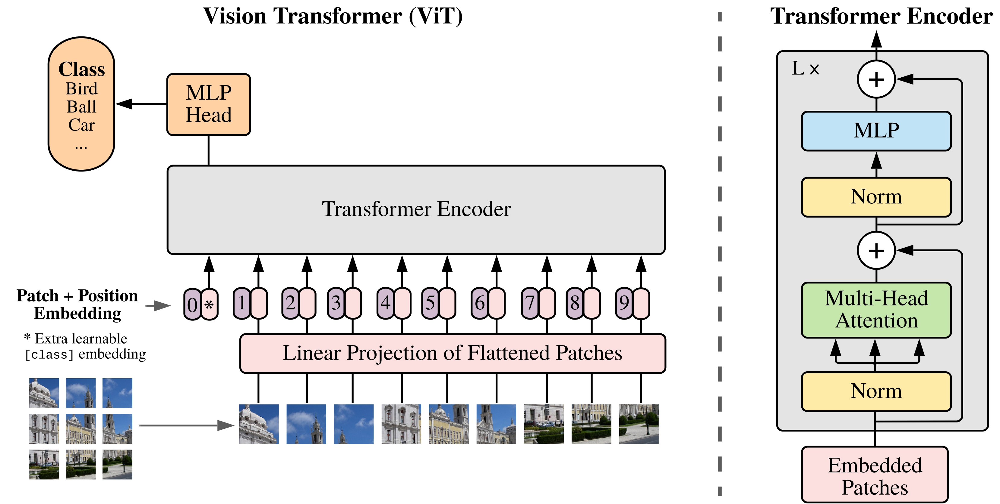

# Understanding a Pretrained Vision Transformer

A step-by-step Jupyter notebook showing how a pretrained Vision Transformer (ViT) processes an image, from its pixels to an ImageNet prediction. The tutorial uses real model weights and intermediate outputs, with numerical checks to connect the calculations to the architecture.

<p align="center">
  
</p>
<p align="center"><em>Vision Transformer architecture, based on Dosovitskiy et al. (2021).</em></p>

## What the notebook covers

The notebook follows the ViT forward pass in the order shown in the diagram:

1. **Image preparation:** Load an image and inspect the processed 224 × 224 input and its 196 patches.
2. **Patch selection:** Select and enlarge a 16 × 16 patch.
3. **Patch projection:** Examine pixel values and reproduce a learned patch embedding using the model's actual projection weights.
4. **CLS and positional embeddings:** Construct the 197 input tokens and compare them with the model's output.
5. **Self-attention:** Calculate queries, keys, values, attention weights, and the attention output from the first encoder block.
6. **Attention heads:** Compare where the 12 heads assign attention for a selected query patch.
7. **Transformer encoder:** Inspect token representations through the 12 encoder blocks.
8. **Image classification:** Use the pretrained classification head to display the top five ImageNet predictions.
9. **Attention rollout:** Visualize CLS-to-patch attention propagated across encoder layers.

The notebook checks the manually calculated patch projection and first-block attention output against the pretrained model. Attention visualizations describe token interactions; they are not proofs of which image regions caused a prediction.

## Model

The tutorial uses **[google/vit-base-patch16-224](https://huggingface.co/google/vit-base-patch16-224)**, a pretrained ViT-Base/16 image classifier.

| Property | Value |
|---|---|
| Input size | 224 × 224 RGB |
| Patch size | 16 × 16 |
| Image patches | 196 |
| Tokens including CLS | 197 |
| Embedding dimension | 768 |
| Encoder blocks | 12 |
| Attention heads per block | 12 |
| Classification outputs | 1,000 ImageNet classes |

The model weights are **not included** in this repository. Hugging Face Transformers downloads and caches them when the model-loading cell runs for the first time. You can also view and download the files from the model page above.

## Run the notebook

1. Download or clone this repository.
2. Install the required Python packages:

   ```powershell
   python -m pip install torch transformers pillow matplotlib numpy jupyter
   ```

3. Open `VIT_Tutorial.ipynb` in Jupyter or VS Code.
4. In Section 2, set `image_path` to the filename of an image in the notebook directory, for example:

   ```python
   image_path = "cat.jpg"
   ```

5. Run the cells in order. An internet connection is needed the first time the pretrained model is downloaded.

The image processor prepares the selected image for the model. You do not need to resize your image manually. The notebook runs inference and visualizations; it does not train or fine-tune ViT. A GPU is not required.

## Files

| File | Purpose |
|---|---|
| `VIT_Tutorial.ipynb` | Main tutorial |
| `model_scheme.jpg` | Architecture diagram used in the introduction |
| `cat.jpg`, `horse.jpg`, `lion.jpg` | Example images for the notebook |

## References

- Dosovitskiy, A., et al. (2021). [*An Image Is Worth 16x16 Words: Transformers for Image Recognition at Scale*](https://arxiv.org/abs/2010.11929). ICLR 2021.
- Hugging Face. [ViT-Base/16 model and pretrained weights](https://huggingface.co/google/vit-base-patch16-224).

The architecture diagram is based on the original ViT paper. Refer to the paper for the original architecture and research results.
